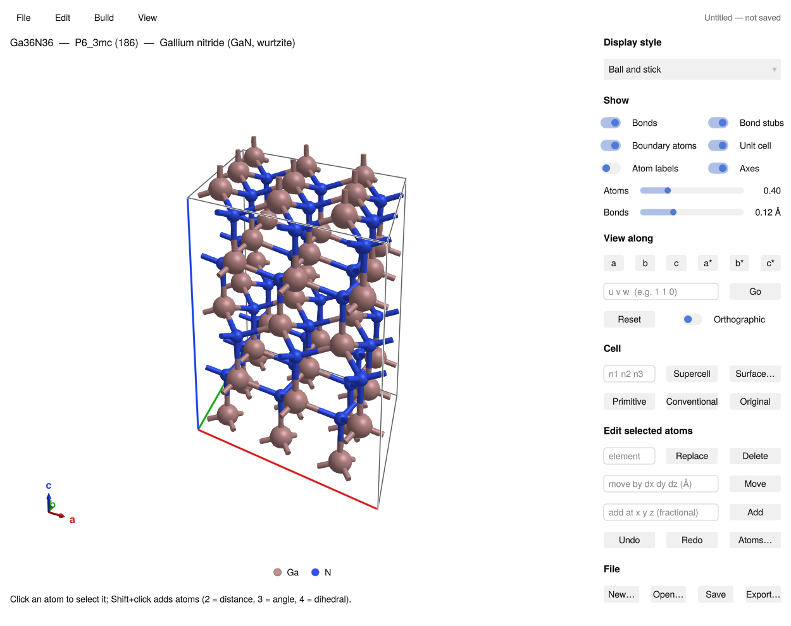
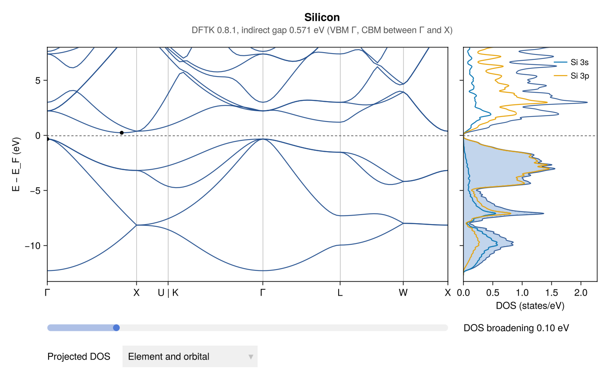

# AtomBond.jl

[](https://quantumworm.github.io/AtomBond.jl/dev/)
[](https://github.com/QuantumWorm/AtomBond.jl/actions/workflows/CI.yml)
[](https://codecov.io/gh/QuantumWorm/AtomBond.jl)

AtomBond is a crystal-structure builder and interactive ball-and-stick viewer
written in Julia (GLMakie). It is meant for preparing ab-initio (DFT)
calculations: open or build a structure, edit it, set relaxation constraints,
and export inputs for open-source codes such as Quantum ESPRESSO, ABINIT,
SIESTA and DFTK.jl.



- Reads and writes the common structure formats (CIF, XYZ, Quantum
  ESPRESSO, ABINIT, SIESTA, LAMMPS, XSF, PDB, …), with a built-in library of crystals (from the
  Crystallography Open Database) and molecules (experimental geometries
  from the literature).
- Builds supercells, slabs, superlattices and molecules in a box; edits
  atoms with undo; keeps several structures open in tabs.
- Labels bond lengths, angles, dihedrals, coordinates, charges and magnetic
  moments, and detects space groups (spglib).
- Writes DFT inputs with k-point meshes, fixed atoms and cell constraints.
- Runs calculations and shows the results: DOS, band structure and
  relaxation steps (below).

## Calculations

File → *Run calculation…* runs the open structure with a DFT code.
[DFTK.jl](https://dftk.org) is the default: it is open source, and AtomBond
installs it into its own environment on the first run, with its
pseudopotentials. You can also use your own installation of an open-source
code such as Quantum ESPRESSO, a licensed code such as CASTEP, or add
another code through a short adapter. The programs are never part of
AtomBond; it only writes their input, starts them and reads their output
([DFT engines](https://quantumworm.github.io/AtomBond.jl/dev/engines/)).



More in [Examples](https://quantumworm.github.io/AtomBond.jl/dev/examples/):
the
projected DOS of GaAs, the band structure of MgO and a cell relaxation.

## Installation

AtomBond needs Julia 1.10 or newer and OpenGL 3.3. Install it from the
General registry:

```julia
using Pkg
Pkg.add("AtomBond")
```

Installing compiles AtomBond and caches a typical session (reading files,
the window, its tools), which takes a few minutes once; afterwards the
window opens in seconds.

## Usage

```julia
using AtomBond
visualize("structure.cif")           # a file in any supported format
visualize(load_library("GaN"))       # a structure from the built-in library
visualize()                          # an empty cell, to build a new structure
```

The same functions work without a window:

```julia
si = load_library("Silicon")
spacegroup(si)                                   # (227, "Fd-3m")
write_qe("si.in", supercell(si, 2, 2, 2); ecutwfc=40, pseudo="{El}.UPF")
```

See the [documentation](https://quantumworm.github.io/AtomBond.jl/dev/) for
the window, building and editing, file formats, DFT inputs and the API.

## Development

```bash
julia --project=. -e 'using Pkg; Pkg.test()'                  # tests
julia --project=docs -e 'using Pkg; Pkg.instantiate()'         # docs, once
julia --project=docs docs/make.jl                              # build docs/build
julia --project=. scripts/run_atombond.jl [file]               # open a window
```

`scripts/build_element_table.jl` and `scripts/build_library.jl` rebuild the
element table and the structure library from their published sources.

## Use of AI

Most of AtomBond's code, tests and documentation were written with Claude
Code (Anthropic) under my direction; the commits say so. I review the
changes and check the results. The structure library was collected the same
way, and each entry comes from its original source (Crystallography Open
Database, or the experimental geometry in the cited paper), with the
reference stored with it. The test suite runs in CI. Calculations were
checked by running the same structures with DFTK.jl, Quantum ESPRESSO and
CASTEP; the comparison is in the *Checked* table on the
[DFT engines](https://quantumworm.github.io/AtomBond.jl/dev/engines/) page.

## License

MIT, see [LICENSE](LICENSE).
