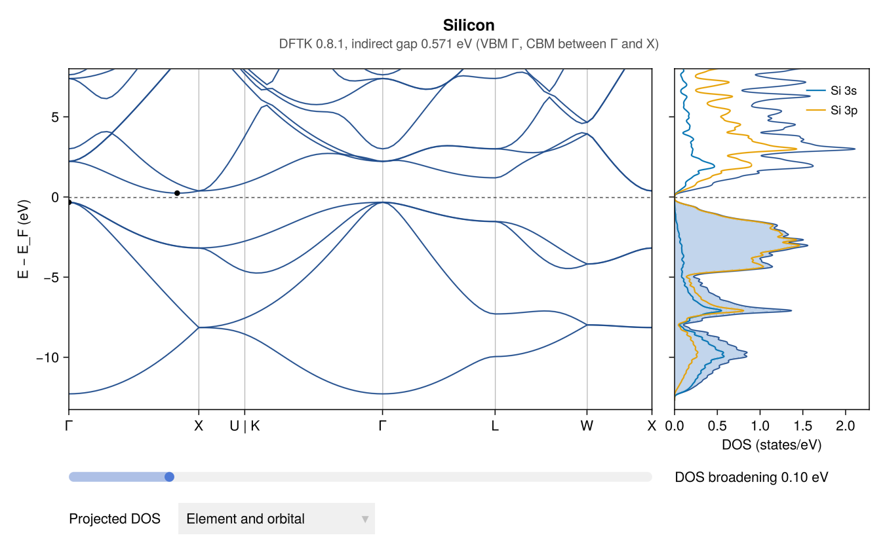
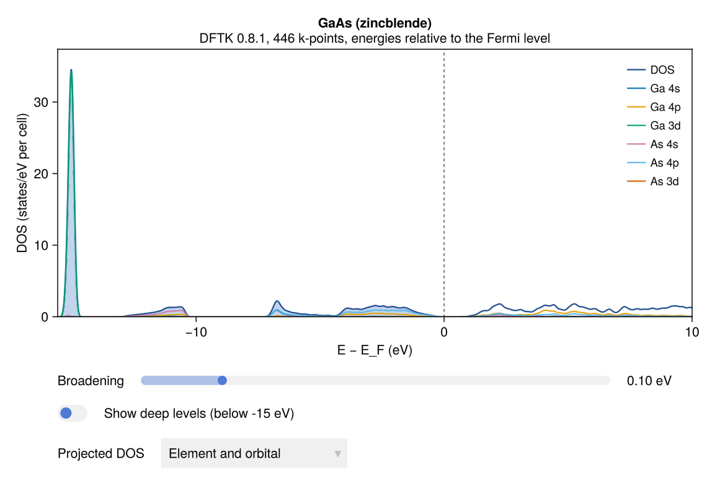
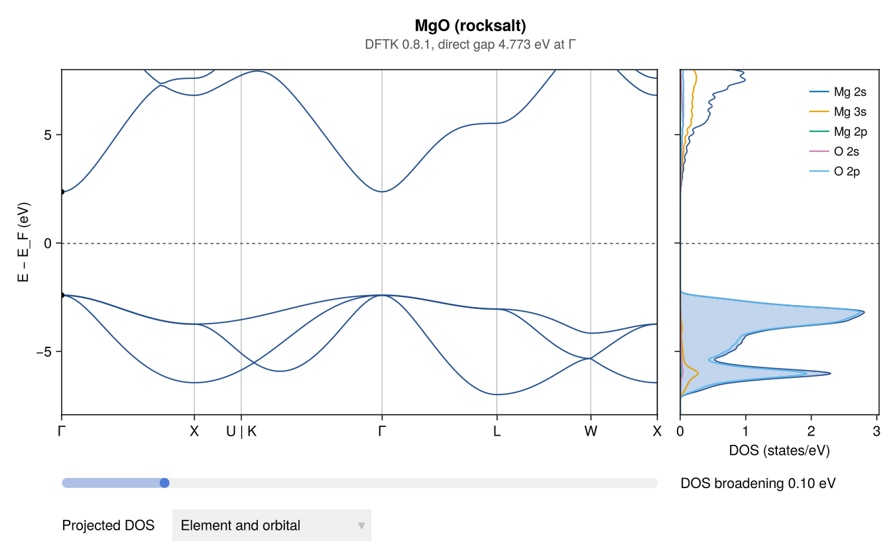

# Examples of calculations

These figures come from real DFTK runs started from AtomBond, with the
structures of the built-in library. The windows look the same when the run
is started from File → *Run calculation…*; this page shows the code that
does it without the window. Each figure has a *Save* button that writes the
picture and the data as CSV.

DFTK is the default engine and is installed on the first run
([Running DFTK](dft.md#Running-DFTK-from-AtomBond)). The same figures work
for Quantum ESPRESSO and CASTEP runs, or for a code you add yourself
([DFT engines](engines.md)), as far as the results contain the levels or
the relaxation steps.

## Band structure and DOS of silicon

```julia
using AtomBond
si = primitive_cell(load_library("Silicon"))
job = run_dftk(si; bands=true, ecutwfc=recommended_ecut(si), kspacing=0.2)
wait(job)
r = job_results(job)
plot_bands(r)          # band structure next to the DOS
```



The band structure follows the standard high-symmetry path of the lattice.
The valence-band maximum and the conduction-band minimum are marked, and
the subtitle gives the gap: indirect for silicon, 0.57 eV with PBE (PBE underestimates
gaps; the measured gap is 1.12 eV).

## Projected DOS of GaAs

With orbital projections, the DOS shows each element's s, p and d states
(the *Projected DOS* menu changes the grouping). The narrow peak at −15 eV
is the Ga 3d band. The As 3d levels, near −35 eV, are left out of the view
until *Show deep levels* is switched on. The gap is direct at Γ, 0.52 eV
with PBE (measured: 1.42 eV).

```julia
gaas = primitive_cell(load_library("Gallium arsenide (GaAs)"))
job = run_dftk(gaas; bands=true, ecutwfc=recommended_ecut(gaas), kspacing=0.2)
wait(job)
plot_dos(job_results(job))
```



## Band structure of MgO

An ionic insulator: the valence band is O 2p, and the gap is direct at Γ,
4.77 eV with PBE (measured: 7.8 eV).

```julia
mgo = primitive_cell(load_library("Magnesium oxide (MgO)"))
job = run_dftk(mgo; bands=true, ecutwfc=recommended_ecut(mgo), kspacing=0.2)
wait(job)
plot_bands(job_results(job))
```


