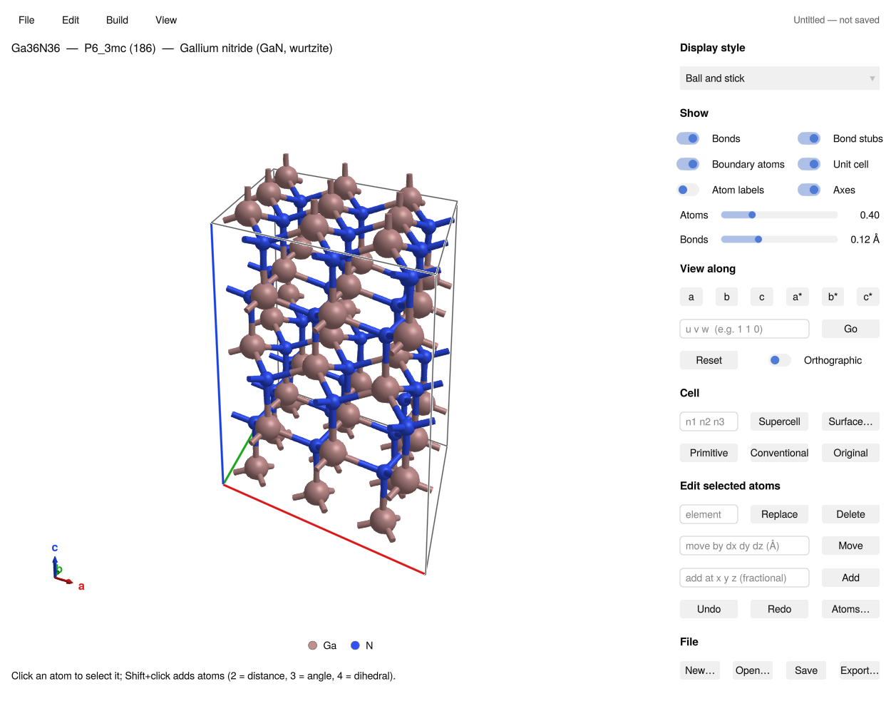
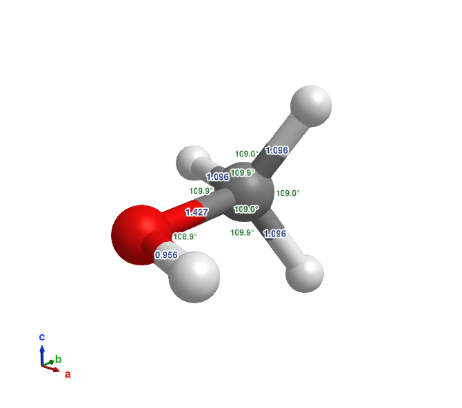

# AtomBond.jl

AtomBond is a crystal-structure builder and interactive ball-and-stick viewer
written in Julia with [GLMakie](https://docs.makie.org). It is meant for
preparing ab-initio (DFT) calculations: open or build a structure, edit it,
set relaxation constraints, and export input files for open-source codes such
as Quantum ESPRESSO, ABINIT and SIESTA.



## Features

- **Viewer:** ball and stick, CPK, stick and line styles; bonds across
  periodic boundaries; views along lattice and reciprocal axes or any [uvw];
  orthographic camera; PNG export; several structures in tabs.
- **Formats:** reads and writes CIF, XYZ, Quantum ESPRESSO, ABINIT, SIESTA,
  LAMMPS, XSF, PDB, SHELX `.res` and the input formats of several other
  codes; also reads cube files and DFT outputs ([File formats](formats.md)).
- **Building:** supercells (including general matrices), primitive and
  conventional cells, surfaces and slabs, superlattices, molecules in a
  periodic box, shifting, rotating and wrapping atoms, bridging atoms
  ([Building and editing](building.md)).
- **Editing:** select atoms with the mouse, then delete, substitute, add or
  move them, with undo and redo.
- **Analysis:** space group detection (spglib); labels for bond lengths,
  angles, dihedrals, coordinates, charges and magnetic moments
  ([Labels](labels.md)).
- **DFT inputs:** fixed atoms and cell constraints, k-point meshes and spin
  ([DFT inputs](dft.md)).
- **Structure library:** 149 crystals and molecules: Crystallography Open
  Database structures and experimental geometries from the literature, each
  with its reference
  ([Library and element data](library.md)).



## Installation

AtomBond needs Julia 1.10 or newer and OpenGL 3.3 (any desktop; on Windows it
also runs in WSL2). It is not registered yet, so install it from GitHub:

```julia
using Pkg
Pkg.add(url="https://github.com/QuantumWorm/AtomBond.jl")
```

Installing compiles AtomBond and caches a typical session (reading files,
the window, its tools), which takes a few minutes once; afterwards the
window opens in seconds.

## Getting started

```julia
using AtomBond
visualize("structure.cif")           # a file in any supported format
visualize(load_library("GaN"))       # a structure from the built-in library
visualize()                          # nothing yet: build a new structure
```

`visualize()` opens an empty cell with the *New structure* tool on the right:
pick a prototype (diamond, zincblende, rocksalt, wurtzite, perovskite, …) and
type your elements and lattice constants, or keep the empty cell and add
atoms one by one. Left-drag rotates, the scroll wheel zooms and right-drag
pans. The first start takes a minute or two while Julia compiles GLMakie.

From a script (`julia script.jl`), keep the window open with

```julia
v = visualize("structure.cif")
wait(v.screen)
```

The same functions work without a window; see
[Working from Julia code](scripting.md).

## WSL2

Under WSL2, AtomBond draws with software OpenGL, because the WSL GPU driver
(Mesa D3D12) can freeze when many items are added to an open window, as when
a tool opens. That is fast enough for typical cells. To use the GPU anyway,
start Julia with `ATOMBOND_GPU=1`; setting `LIBGL_ALWAYS_SOFTWARE` or
`GALLIUM_DRIVER` yourself also takes precedence. Native Windows, macOS and
Linux use the GPU.
